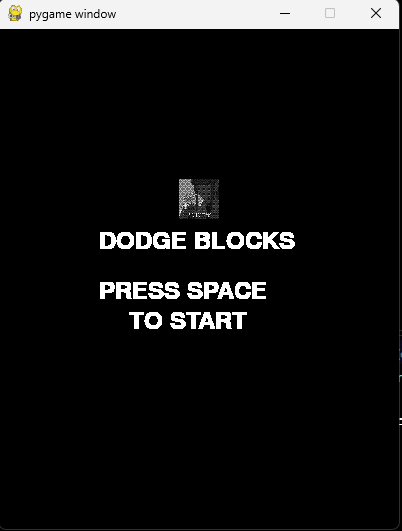
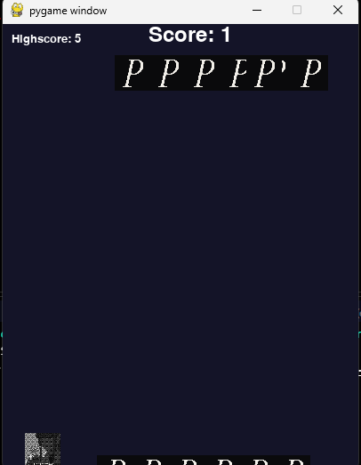
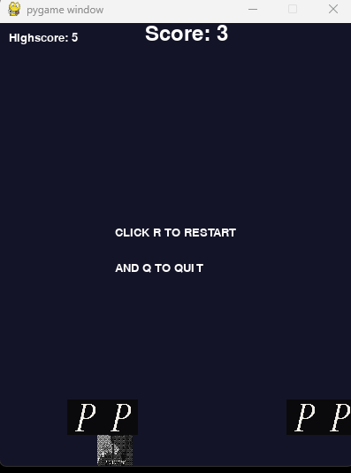

# dodgeblocks
Dodge the falling blocks

This is my first pygame project , doesn't have much but I'll learn

Tools used:
>Pygame python

Access:
>https://shimes.itch.io/dodge-block

USECASE:
>Fun game (not sure about the fun part)

Why i built it:
>To learn pygame and this seemed the perfect idea to start off with

AI USAGE:
>Mostly used w3school and few tutorials to make this but sometimes used claude to learn things
>For making the falling blocks phantom image
>Google overview

PROBLEMS I FACED:
>As my first pygame project i had to learn a lot of new things and how everything worked, took me some to get a hang of this

#SCREENSHOTS
>Opening screen

>Actual game

>Death screen
